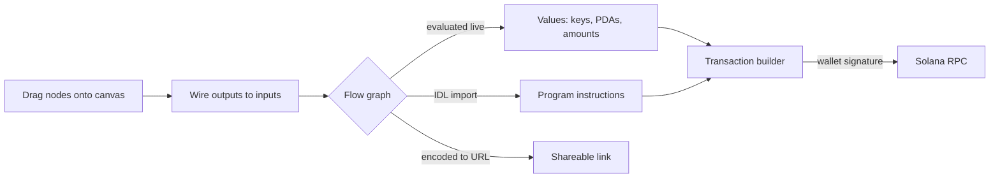

<p align="center">
  <a href="https://redduck.io/?utm_source=github&amp;utm_medium=readme&amp;utm_campaign=PLGRND">
    <picture>
      <source media="(prefers-color-scheme: dark)" srcset=".github/assets/redduck-logo-dark.svg">
      
    </picture>
  </a>
</p>

<h1 align="center">PLGRND</h1>

<p align="center">
  <b>Build Solana flows by dragging nodes — keypairs, PDAs, instructions, transactions — and run them against a live cluster.</b>
</p>

---

PLGRND is a visual playground for Solana. Instead of writing a script to derive an ATA, build an instruction and send a transaction, you wire together nodes on a canvas: each one is a ready, tested block of code with typed inputs and outputs. Values flow along the edges and evaluate live, so you see the actual public key, the actual lamport amount, the actual transaction at every step. Import a program's IDL and its instructions become nodes you can call. Every flow encodes into its own URL, so a working example is a link you can send to someone.

## Built with

| Area         | Technology                                                                                                                                                                                        |
| ------------ | ------------------------------------------------------------------------------------------------------------------------------------------------------------------------------------------------- |
| App          | React 19 + TypeScript, [Vite](https://vite.dev/)                                                                                                                                                  |
| Canvas       | [React Flow](https://reactflow.dev/) (`@xyflow/react`)                                                                                                                                            |
| Solana       | [`@solana/web3.js`](https://github.com/solana-foundation/solana-web3.js), [`@solana/spl-token`](https://github.com/solana-program/token), [Anchor](https://www.anchor-lang.com/) for IDL decoding |
| Wallets      | [Solana Wallet Adapter](https://github.com/anza-xyz/wallet-adapter)                                                                                                                               |
| Crypto       | `tweetnacl`, `bip39`, `ed25519-hd-key`, `bs58`                                                                                                                                                    |
| State & data | [Zustand](https://zustand.docs.pmnd.rs/), [TanStack Query](https://tanstack.com/query)                                                                                                            |
| UI           | Tailwind CSS v4, Radix UI, `lucide-react`, `sonner`                                                                                                                                               |
| Tooling      | Yarn 4 workspaces, ESLint, Prettier                                                                                                                                                               |
| Deploy       | Cloudflare Workers (`wrangler`)                                                                                                                                                                   |

## How it works



1. Pick nodes from the menu and drop them on the canvas — each category maps to a piece of the Solana model.
2. Connect handles; the graph re-evaluates on every change, so downstream nodes update as you type.
3. Feed the result into a transaction builder, connect a wallet, and send it to the cluster of your choice.
4. Hit share — the whole graph is compressed into the URL hash. Hand someone the link, or use **Share → Embed** to generate a themed interactive widget for any page (see [Embedding](#embedding)).

## Node categories

| Category              | Nodes                                                                                                       |
| --------------------- | ----------------------------------------------------------------------------------------------------------- |
| Input                 | Text, number, display, comment                                                                              |
| Math / String / Logic | Arithmetic, combine, split, substring, search, replace, length, compare, equality, `if`, booleans           |
| Crypto                | Keypair, mnemonic, private key, hash, sign, verify signature                                                |
| Wallet / Network      | Connected wallet, cluster selection, balance                                                                |
| Utils                 | SOL ↔ lamports, token amounts, ATA derivation, rent exemption, public key validation, string encode/decode |
| Programs              | IDL import, program instructions, program accounts, PDA derivation                                          |
| Transactions          | Transaction builder, transaction, transaction view                                                          |

Built-in example flows cover hashing, signature verification, balance checking, a SOL transfer and a program call — each one loads straight onto the canvas.

## Embedding

Any PLGRND flow can be embedded on another site as an interactive widget — an `<iframe>` pointed at `/embed`, no JavaScript required on the host page:

```html
<div style="position:relative;width:100%;aspect-ratio:16/9;overflow:hidden;border-radius:12px">
  <iframe
    src="https://plgrnd.io/embed?theme=light&bg=e0deda&accent=ed4937#flow=…"
    title="PLGRND interactive flow"
    loading="lazy"
    sandbox="allow-scripts allow-same-origin allow-popups allow-popups-to-escape-sandbox"
    allow="clipboard-write"
    style="position:absolute;inset:0;width:100%;height:100%;border:0"
  ></iframe>
</div>
```

The easiest way to get a snippet is the built-in builder: open a flow, hit **Share → Embed**, tune the options against the live preview and copy the result.

### URL parameters

Options travel in the query string; the flow itself stays in the `#flow=` hash. Options are also accepted inside the hash after `?`, which keeps old links working. Invalid values never break rendering — they fall back to their defaults.

| Parameter  | Values                                                                      | Default        | Effect                             |
| ---------- | --------------------------------------------------------------------------- | -------------- | ---------------------------------- |
| `mode`     | `readonly` · `interactive` · `editor`                                       | `interactive`  | Interaction level (see below)      |
| `theme`    | `dark` · `light` · `auto`                                                   | `dark`         | Palette preset                     |
| `bg`       | hex without `#` (3, 4, 6 or 8 digits)                                       | from theme     | Canvas background                  |
| `surface`  | hex                                                                         | from theme     | Node bodies, panels, popovers      |
| `fg`       | hex                                                                         | from theme     | Text                               |
| `border`   | hex                                                                         | from theme     | Borders and input outlines         |
| `accent`   | hex                                                                         | from theme     | Highlights and focus ring          |
| `radius`   | integer `0`–`24`                                                            | `8`            | Corner radius in px                |
| `font`     | font-family string (letters, digits, spaces, `,`, quotes, `-`; ≤ 100 chars) | PLGRND default | UI font                            |
| `fontMono` | same rules                                                                  | PLGRND default | Monospace font                     |
| `controls` | `1`/`0`                                                                     | `1`            | Zoom/fit controls                  |
| `minimap`  | `1`/`0`                                                                     | `0`            | MiniMap                            |
| `toolbar`  | `1`/`0`                                                                     | `1`            | "Open in PLGRND" + "Reset" buttons |

Unknown parameters are ignored. `id=` is reserved for future server-stored flows and is read from the query string only. The "Powered by PLGRND" badge is always shown.

### Interaction modes

| Behaviour                                                | `readonly` | `interactive` | `editor` |
| -------------------------------------------------------- | ---------- | ------------- | -------- |
| Pan and zoom (Controls / pinch)                          | ✔         | ✔            | ✔       |
| Edit values inside nodes (inputs, `Generate`, `Refresh`) | ✖         | ✔            | ✔       |
| Move, connect, add or delete nodes                       | ✖         | ✖            | ✔       |
| Header with the node menu                                | ✖         | ✖            | ✔       |

Wallet connection is never available inside the widget: the Wallet node deep-links to the full editor with the current canvas state instead. `Send` works inside the widget when the transaction is signed by a private key supplied in the flow (for example a throwaway devnet key pasted into a Private key or Keypair node); when signing requires a connected wallet, `Send` deep-links to the full editor as well. Read-only RPC (balances, account info, transaction views) always works.

### Theming

`theme=dark|light` picks a preset and the colour tokens above apply on top. **`theme=auto` follows the visitor's OS setting (`prefers-color-scheme`), not your site's own theme toggle** — if your site switches dark mode with a class or a button, pin `theme=` to the value you render, or drive the widget at runtime via `postMessage`.

Each widget posts `{ type: 'plgrnd:ready' }` to its **direct parent** once the flow has rendered (a nested shell must relay it upward if needed), and accepts exactly one inbound message shape — anything else is ignored:

```js
frame.contentWindow.postMessage({ type: 'plgrnd:theme', theme: 'dark' }, '*')
```

With several widgets on one page, resolve the sender via `event.source` — never guess iframes by `src`:

```html
<script>
  // Multi-widget-safe host-side theme sync.
  const hostTheme = () => (document.documentElement.classList.contains('dark') ? 'dark' : 'light')
  const widgets = new Set()
  window.addEventListener('message', (e) => {
    if (e.data?.type !== 'plgrnd:ready') return
    widgets.add(e.source)
    e.source.postMessage({ type: 'plgrnd:theme', theme: hostTheme() }, '*')
  })
  // Call this from your own theme toggle:
  const syncWidgets = () => widgets.forEach((w) => w.postMessage({ type: 'plgrnd:theme', theme: hostTheme() }, '*'))
</script>
```

Widget appearance is not trusted state: any script able to reach the widget's `contentWindow` — including third-party scripts on the host page — can change its theme. The message affects visuals only.

### Iframe requirements and behaviour

- `sandbox` needs `allow-scripts allow-same-origin`, plus `allow-popups allow-popups-to-escape-sandbox` for "Open in PLGRND" and the badge link; `allow="clipboard-write"` enables click-to-copy inside nodes. Without popup permissions the widget falls back to a copyable link in a toast.
- The mouse wheel over the widget scrolls the host page (same convention as embedded maps); zooming works through the Controls, pinch, or Ctrl/Cmd+wheel.
- Embeds are stateless: visitor edits live only inside the iframe, reloading it (or pressing Reset) restores the authored flow, and nothing is read from or written to the visitor's PLGRND storage.

### Legacy links

Old-style `https://plgrnd.io/#flow=…?view=true` links keep working — they are rewritten client-side to `/embed` with default options.

## Self-hosted embedding

`<plgrnd-flow>` renders the same widget directly in your page, without an iframe. You serve the file yourself, from your own site or bundle. At runtime the widget loads no Google Fonts, no analytics, no remote CSS and nothing from plgrnd.io. Its only requests go to the Solana RPC endpoints. It writes no cookies and no storage. Shadow DOM keeps your site's CSS out of the widget, and the widget's CSS out of your site.

The widget ships as the npm package [`@plgrnd/embed`](packages/embed) and as versioned downloads under `https://plgrnd.io/sdk/<version>/`. To get a snippet, open **Share → Embed → Self-hosted** and pick HTML, MDX, Mintlify or Markdoc. The snippet carries the same flow payload and options as the iframe snippet.

### Files and sizes (1.0.1)

| File                                       | Raw      | gzip   | Use                                                    |
| ------------------------------------------ | -------- | ------ | ------------------------------------------------------ |
| `plgrnd-flow-1.0.1.js`                     | 1,255 kB | 395 kB | Classic script, everything in one file                 |
| `plgrnd-flow-1.0.1/plgrnd-flow.js`         | 7 kB     | 3 kB   | ESM entry: defines the element                         |
| `plgrnd-flow-1.0.1/plgrnd-flow-runtime.js` | 1,322 kB | 394 kB | ESM runtime, loaded the first time an element connects |

Download the files once and serve them yourself. Never hot-link `plgrnd.io/sdk`. The version is in the file name, so a page keeps exactly the build it was tested with.

```html
<!-- classic script, once per page -->
<script src="/plgrnd-flow-1.0.1.js"></script>

<!-- or the ESM folder, served as-is -->
<script type="module" src="/plgrnd-flow-1.0.1/plgrnd-flow.js"></script>

<plgrnd-flow flow="N4Ig…" theme="auto" style="display:block;aspect-ratio:16/9;min-height:320px"></plgrnd-flow>
```

With a bundler, use `npm install @plgrnd/embed` and then `import '@plgrnd/embed'`. On the server that import resolves to an empty module, so SSR frameworks can import it anywhere. The package also ships TypeScript types for `<plgrnd-flow>` in React 18 and 19 JSX.

### Attributes

| Attribute                                 | Values                           | Default                                              |
| ----------------------------------------- | -------------------------------- | ---------------------------------------------------- |
| `flow`                                    | The payload from the snippet     | —                                                    |
| `theme`                                   | `dark` · `light` · `auto`        | `dark`                                               |
| `bg`, `surface`, `fg`, `border`, `accent` | Hex, with or without `#`         | From the theme                                       |
| `radius`                                  | `0`–`24` (px)                    | `8`                                                  |
| `font`, `font-mono`                       | A font-family string             | Your page's font · the system monospace stack        |
| `controls`, `minimap`, `toolbar`          | `1` · `0` · `true` · `false`     | `1` · `0` · `1`                                      |
| `mode`                                    | `readonly` · `interactive`       | `interactive` (`editor` falls back to `interactive`) |
| `rpc-mainnet`, `rpc-devnet`               | `http:` or `https:` JSON-RPC URL | The public cluster endpoints                         |
| `link-ref` (also `ref` in plain HTML)     | `[A-Za-z0-9._-]{1,64}`           | — (added as `?ref=` to the plgrnd.io links)          |

How attributes behave:

- Invalid values fall back to the defaults, silently.
- Every attribute also exists as a camelCase property, such as `fontMono`, `rpcDevnet` or `linkRef`. Properties do not reflect to attributes, and the last write wins.
- The element fires `plgrnd:ready` after each successful (re)initialization. The event bubbles, is composed, and carries `detail.version`.
- A widget mounts when it comes within one viewport height of the visible area, so an off-screen widget fires `plgrnd:ready` only after the reader scrolls near it.

`theme="auto"` follows your site's own toggle, live. It checks these markers in order:

1. `body[data-md-color-scheme]` (MkDocs Material). `slate` or `dark` means dark, and `default` or `light` means light. For any other value, the luminance of the body background decides.
2. `html[data-theme]` (Docusaurus).
3. A `dark` or `light` class on `<html>` (Mintlify, next-themes, Fumadocs).
4. `prefers-color-scheme`.

### RPC

The defaults are `https://api.mainnet-beta.solana.com` and `https://api.devnet.solana.com`. Both are rate-limited public endpoints, so production docs should pass their own, for example `rpc-mainnet="https://…"`.

Transactions are confirmed by HTTPS polling, so the widget never opens a WebSocket. No private RPC key is compiled into the files. A key you put in an attribute is visible in your page source, so restrict it by referrer.

### Content Security Policy

These rules come from measurements on `packages/embed/fixtures/strict-csp.html` (CSP: `script-src 'self'`, `https:` RPC only, no `wss:`; 0 violations).

- **`script-src`.** Allow the origin that serves the file. No `'unsafe-eval'`, no `blob:` and no `data:` scripts are needed, and the widget starts no workers.
  - **`'strict-dynamic'`:** works, with 0 violations.
  - **Trusted Types:** with a static `<script src>`, the widget raises no Trusted Types violations. A host script that injects the `<script>` itself needs its own Trusted Types policy.
- **`connect-src`.** Allow your RPC endpoints, over `https:` only. `wss:` is not needed.
- **`style-src`.** No `'unsafe-inline'` is needed, because styles use constructable stylesheets and the CSSOM. Browsers without constructable stylesheets (Safari before 16.4) fall back to a `<style>` element inside the shadow root, which does need `'unsafe-inline'`.

The snippets reserve space with an inline style. To reserve space for every widget before the script runs, add:

```css
plgrnd-flow:not(:defined) {
  display: block;
  aspect-ratio: 16 / 9;
  min-height: 320px;
}
```

### Recipes

**Mintlify.**

1. Put `plgrnd-flow-1.0.1.js` at the root of the docs repo. Mintlify injects every `.js` file in the repo into every page, so keep exactly one version file. Never add the ESM folder: its files would be injected as classic scripts too.
2. Add `snippets/plgrnd-flow.jsx`:

   ```jsx
   export const PlgrndFlow = ({ style, ...props }) => (
     <plgrnd-flow style={{ display: 'block', aspectRatio: '16/9', minHeight: 320, ...style }} {...props} />
   )
   ```

3. Use it on a page. The **Mintlify** format of the Share dialog has this shape:

   ```mdx
   import { PlgrndFlow } from '/snippets/plgrnd-flow.jsx'

   <PlgrndFlow flow="N4Ig…" theme="auto" />
   ```

**Docusaurus.** Copy the ESM folder to `static/plgrnd-flow-1.0.1/`, then load it from `docusaurus.config.js` (prefix `baseUrl` if it is not `/`):

```js
scripts: [{ src: '/plgrnd-flow-1.0.1/plgrnd-flow.js', type: 'module' }],
```

Alternatively, run `npm install @plgrnd/embed` and add a client module (`clientModules: [require.resolve('./src/plgrnd.js')]`) whose only line is `import '@plgrnd/embed'`. In MDX, use the **MDX** format (`<plgrnd-flow … style={{ … }} />`).

**MkDocs Material.** Copy the ESM folder to `docs/javascripts/`, then load it from `mkdocs.yml`:

```yaml
extra_javascript:
  - path: javascripts/plgrnd-flow-1.0.1/plgrnd-flow.js
    type: module
```

Paste the **HTML** format into the Markdown. `theme="auto"` follows the palette toggle, and instant navigation mounts and unmounts widgets with the page.

**Next.js / Fumadocs.** Register the element once, in a client component rendered by the root layout:

```tsx
'use client'
import '@plgrnd/embed'

export default function PlgrndFlowRegister() {
  return null
}
```

Then use the **MDX** format in your pages. On the server the import is an empty module, and the element renders nothing into light DOM, so hydration never mismatches.

**Markdoc.** Add a tag and a component. The **Markdoc** format produces ``. Add `rpcMainnet`, `rpcDevnet` or `linkRef` to a tag yourself when you need them.

```js
// markdoc/tags.js, inside the tags object
'plgrnd-flow': {
  selfClosing: true,
  render: PlgrndFlow,
  attributes: Object.fromEntries(
    ['flow', 'theme', 'bg', 'surface', 'fg', 'border', 'accent', 'radius', 'font', 'fontMono',
     'controls', 'minimap', 'toolbar', 'mode', 'rpcMainnet', 'rpcDevnet', 'linkRef',
     'aspect', 'height'].map((name) => [name, { type: String }])
  ),
},
```

```jsx
// components/PlgrndFlow.jsx
import '@plgrnd/embed'

export function PlgrndFlow({ aspect = '16/9', height, fontMono, rpcMainnet, rpcDevnet, linkRef, ...attributes }) {
  const style = height
    ? { display: 'block', height: `${height}px`, minHeight: 0 }
    : { display: 'block', aspectRatio: aspect, minHeight: 320 }
  return (
    <plgrnd-flow
      {...attributes}
      font-mono={fontMono}
      rpc-mainnet={rpcMainnet}
      rpc-devnet={rpcDevnet}
      link-ref={linkRef}
      style={style}
    />
  )
}
```

### Updating

1. Download the new version folder, or run `npm install @plgrnd/embed@<version>`.
2. Check it against `SHA256SUMS.txt`.
3. Replace the old file. On Mintlify, delete the old version file.

Existing snippets keep working. A flow saved by a newer PLGRND than your file supports shows "This flow needs a newer PLGRND widget". Update the file to fix it.

### Limits

- **Wallets.** No wallet connection. `Send` works only with a key signer wired into the flow, as in the iframe.
- **Modes.** No editor mode.
- **Dropdowns and the info dialog.** Dropdowns use the browser's native select popup. The node-info dialog is non-modal and has no focus trap. Escape, the close button and the backdrop close it and return focus. A click outside the widget also closes it, without returning focus.
- **Fonts.** No web fonts are loaded. The sans font follows your page and the monospace font uses the system stack. `font` and `font-mono` override them.
- **JSX attributes.** Pass booleans and numbers as strings, such as `controls="0"`: until the element is defined, React 19 drops a JSX `{false}` and writes `{true}` as an empty attribute.
- **Errors.** Errors raised through React or React Flow callbacks stay inside the widget and are logged with a `[plgrnd]` prefix. Exceptions from other libraries' timers or promises can still reach `window.onerror`.

### Integrity

Each version folder also contains:

- **`SHA256SUMS.txt`:** run `sha256sum -c SHA256SUMS.txt` to check your downloads.
- **`SRI.txt`:** the `sha384-…` values for `<script integrity>`.
- **`THIRD_PARTY_LICENSES.txt`:** the licences of the bundled packages.

## Contributing

Anyone can add nodes — upstream into this repository (they ship on plgrnd.io) or in your own fork and deployment. The full guide, from the node contract to the PR checklist, is in [CONTRIBUTING.md](CONTRIBUTING.md). Node PRs must also extend the [Node categories](#node-categories) table above.

## Getting started

Prerequisites: Node.js v22 or higher, Yarn 4+.

```bash
yarn install    # install workspace dependencies
yarn web:dev    # run the web app in development mode
yarn web:build  # production build
```

Optionally set `VITE_PUBLIC_SOLANA_RPC` to point the app at your own RPC endpoint, and `VITE_HELIUS_API_KEY` to route the nodes' RPC calls through Helius (see `apps/web/.env.example`).

## License

[MIT](LICENSE)
